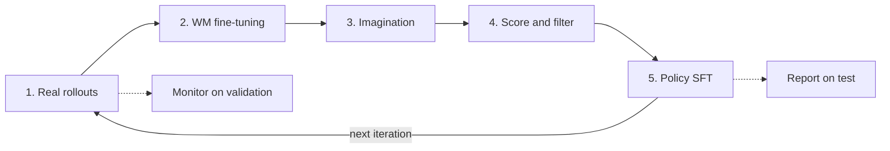

# Imagination SFT on LIBERO-Spatial

This folder holds the loop that improves a Multitask DiT policy with rollouts imagined by the OpenSora world model (WM).
Each iteration collects real rollouts, imagines more from the same initial states, keeps the imagined rollouts that Robometer scores as successes, and fine-tunes the policy on them.

- [Overview](#overview): the loop and the data splits
- [Components](#components): models, configs, and scripts
- [Running an experiment](#running-an-experiment): initial states and the protocol
- [Method](#method): chunk-level selection and how WM and reward errors are measured
- [Rules](#rules): fixed design decisions, code constraints, and the reporting format
- [Data and results](#data-and-results): saved datasets and experiment records

## Overview

### The loop



| Step | Does | Files |
|---|---|---|
| 1. Real rollouts | Run the current policy in LIBERO on imagination states (K reruns). Keep successes and failures; save init id, actions, frames, and sim success. Feeds WM fine-tuning and reward calibration. | `collect_rollouts.py` |
| 2. WM fine-tuning | Fine-tune OpenSora on step-1 rollouts so it matches LIBERO and the current policy (as in WMPO). Measure dynamics error with open-loop replay each iteration. | [RLinf/opensora](https://github.com/RLinf/opensora); monitor: `imagine_rollouts.py --mode replay`, `wm_fidelity.py` |
| 3. Imagination | From each imagination state's real reset frame, roll the policy N times in the WM (closed loop). Limit the horizon to where the WM stays reliable. | `imagine_rollouts.py` |
| 4. Score and filter | Robometer success: 3 scored frames in a row (stride 8) with prob > 0.5; then within-group top-k. Empty groups contribute nothing. | `robometer_judge.py`, `export_imagined.py` (`label_advantages.py` for chunk-level) |
| 5. Policy SFT | Filtered BC / reward-weighted SFT on kept rollouts, mixed with demos. Repeat from step 1 with the new policy. | `rlinf/workers/sft/fsdp_vla_sft_worker.py`, `examples/sft/config/libero_spatial_sft_multitask_dit.yaml` |
| Monitor / report | Open-loop disagreement on validation; SR on the 500 test states. | `wm_fidelity.py`, `evaluations/run_eval.sh`, `report.py`; full pass: `run_protocol.sh` |

### Data splits

Three disjoint init-state sets per task, written by `sample_init_states.py` (see [Initial states](#initial-states)). Demos are separate LeRobot data mixed into policy SFT.

| Split | Role | States / task | Total | Source | Used for | Never used for |
|---|---|---|---|---|---|---|
| Imagination | Train | 30 | 300 | New samples, `pool[10:40]` | Real rollouts, WM fine-tuning, closed-loop imagination, curated SFT data | Reported test SR |
| Validation | Eval / monitor | 10 | 100 | New samples, `pool[0:10]` | Judge calibration, open-loop WM fidelity, checkpoint or threshold choices | Imagination, reported test SR |
| Test | Test | 50 | 500 | LIBERO benchmark | Reported SR (2 reruns → 100 episodes / task, 1,000 total) | Real rollouts, imagination, any tuning |

## Components

### Models and configs

| Part | Code | Config |
|---|---|---|
| Policy: Multitask DiT (LeRobot `MultiTaskDiTPolicy`: CLIP frames + frozen CLIP instruction, DDPM; main camera, 2-frame history, 8-action chunks, no proprio state) | `rlinf/models/embodiment/multitask_dit/` | `examples/embodiment/config/model/multitask_dit.yaml` |
| Policy SFT (`data.episodes_per_task` subsamples demos; `data.advantage_tag` samples labeled chunks) | `rlinf/workers/sft/fsdp_vla_sft_worker.py` | `examples/sft/config/libero_spatial_sft_multitask_dit.yaml` |
| Chunk advantages from Robometer scores | `label_advantages.py` | — |
| Policy eval in LIBERO | `evaluations/run_eval.sh`, `collect_rollouts.py --model-cfg` | `evaluations/libero/libero_spatial_multitask_dit_eval.yaml` |
| World model: action-conditioned OpenSora, 8 frames per 8-action chunk | `rlinf/envs/sim/world_model/` | `examples/embodiment/config/env/opensora_libero_spatial.yaml` |
| WM environment | `requirements/install_opensora_conda.sh` | — |

WM fine-tuning runs in the external [RLinf/opensora](https://github.com/RLinf/opensora) repository, not in RLinf.

### Scripts

| Script | Does | Environment |
|---|---|---|
| `run_protocol.sh` | Runs the whole protocol (see [Protocol](#protocol)) | — |
| `sample_init_states.py` | Samples and splits new initial states (see [Initial states](#initial-states)) | `.venv` |
| `collect_rollouts.py` | Rolls a policy out in LIBERO and saves every episode | `.venv` |
| `anchor/select.py` | Picks imagination start points shortly before real failures (see [Failure anchors](#failure-anchors)) | `.venv` |
| `anchor/score.py` | The failure scores `anchor/select.py --method` chooses from | — |
| `anchor/compare_anchors.py` | Compares the anchors of several `anchor/select.py` outputs (separation AUROC, alarms per task) | `.venv` |
| `imagine_rollouts.py` | Rolls a policy out in the WM (closed loop), or replays real actions in it (open loop) | OpenSora venv |
| `robometer_judge.py` | Labels real or imagined episodes as successes with Robometer | Robometer venv |
| `export_imagined.py` | Writes judged successes (or every rollout, `--all`) as a LeRobot dataset | `.venv` |
| `label_advantages.py` | Labels chunk advantages for chunk-level selection | `.venv` |
| `wm_fidelity.py` | Compares WM rollouts with real ones: closed-loop SR correlation, open-loop disagreement | `.venv` |
| `report.py` | Builds the results table and bootstrap intervals from evaluations | `.venv` |
| `common.py` | Rollout file helpers shared by the scripts above | — |

## Running an experiment

### Initial states

`sample_init_states.py` draws a frozen pool of 100 new states per task from each task's BDDL placement sampler, with robosuite's default 0.02 rad Gaussian noise on the robot's start pose as in the benchmark states (LIBERO's env wrapper turns it off by default), and keeps a state only if it looks like a benchmark state after the env's 15-step wait: the goal is not already met, no object drifts horizontally farther than it does in any benchmark state (at least 1 mm), and its object layout is no closer to a test state than the two closest test states are to each other (layouts compared by the largest per-object horizontal gap).
Fixtures (the cabinet and the stove) are not in a saved state: every `reset` re-places them in the model by up to a few cm, for test and new states alike, so images of the same state differ and no check compares images.
Validation is `pool[0:10]` and imagination `pool[10:40]`; the other 60 per task are reserve, so either split can grow without changing its existing states.

```bash
python examples/imagination/sample_init_states.py --out ~/datastorage/datasets/libero_spatial_states \
  --pool 100 --validation 10 --imagination 30 --seed 0
python examples/imagination/collect_rollouts.py ... \
  --init-states-dir ~/datastorage/datasets/libero_spatial_states/imagination   # omit for test states
```

Each split directory holds LIBERO-format init-state files, loaded through the env key `init_states_dir`; `split.json` records the settings and per-task filter statistics.
State ids are `task * states_per_task + trial` within one split, so keep each split's runs in their own directories.
The stock WM's bundled init frames are not keyed to these states; `imagine_rollouts.py` takes its initial frames from a `collect_rollouts.py` run on the same split.

### Protocol

`run_protocol.sh` runs one experiment end to end with fixed settings, so two runs differ only in the settings recorded in their `protocol.json`.
It starts from the base policy (ep10 @ 30k) and the stock WM, and compares three arms on the test states: **Base**, **Demos only**, and **Demos + imagined**.
Demos + imagined applies the ranking of targeted imagination (8 rollouts per state, top 4) to every task, as broad imagination does, so it changes only task coverage against targeted imagination.
The chunk-level arm, the oracle arm, and WM fine-tuning are not part of it.

```bash
bash examples/imagination/run_protocol.sh ~/datastorage/runs/imagination/protocol_v1
```

| Stage | Does | Settings | Time |
|---|---|---|---|
| `real` | Base policy in LIBERO on the imagination states | 4 reruns per state (1,200 episodes) | ~2 h |
| `anchors` | Only with `ANCHOR_METHOD` set: [failure anchors](#failure-anchors) from the real run | `rnd_oe` recommended; 6-chunk sums, per-step threshold at the 90th percentile, first crossing, 16-step lead | — |
| `imagine` | Base policy closed loop in the WM from each state's real reset frame | 8 rollouts per state (2,400 episodes), 4 parallel parts | ~18 h |
| `judge` | Robometer success calls on the imagined rollouts | threshold 0.5, 3 frames in a row, stride 8 | ~1 h |
| `export` | One dataset per task: per state, the top 4 judged successes, cut at `success_step` | — | minutes |
| `sft_demos`, `sft_imagined` | Fine-tune the base for 10k steps (lr 1e-4 cosine, 500 warmup, batch 256) on the 10 demos per task, or on the demos and imagined data at 50/50 per batch, with equal weight per task in the imagined half | — | ~1.4 h each |
| `eval_*` | Base and both arms on the 500 test states | 2 reruns, seed 0 | ~1.7 h each |
| `monitor` | Open-loop disagreement on the validation run, judged on both sides | — | ~3 h |
| `report` | `report.md` in the format of [Reporting results](#reporting-results), plus kept data and disagreement per task | — | minutes |

Settings are environment variables with the defaults above (`K`, `N`, `KEEP`, `ANCHOR_STEP`, `ANCHOR_METHOD`, `ANCHOR_ARGS`, `SEED`, checkpoints, and paths; see the script header).
A rerun with the same run directory skips finished stages (`<stage>.done`) and refuses changed settings.
`BASE_EVAL` reuses a finished test evaluation of the base policy instead of rerunning it.

## Method

### Chunk-level selection (simplified RECAP)

Instead of keeping whole successful episodes, keep the 8-action chunks with a high advantage from every rollout, successes and failures alike, and train on them with filtered BC.
Robometer stands in for both the reward and the value model, so nothing is trained.

- **Truncation.** Each rollout ends at its Robometer success window (`success_step`); a failure keeps all 240 steps.
  Without this, about two-thirds of the picks are post-success motion, because Robometer's score peaks just after the bowl lands.
  Robometer is causal (frame and score tokens interleave in a causal decoder), so truncating changes no earlier score.
- **Return.** With \(p_j\) the success probability at frame \(j\) (step \(8j\)), set to 1 from the success window on and repeated past the episode end, chunk \(c\) (steps \(8c\) to \(8c+7\)) gets \(G_c = p_{c+1} + \dots + p_{c+4}\), the next 32 steps.
- **Advantage and selection.** \(A_c = G_c - b\), where \(b\) is the mean \(G\) over the task's chunks; the top 30% of each task's chunks are positive.
- **Training.** `data.advantage_tag` samples only positive frames of a dataset; the other frames remain as history.

Example: two task-1 chunks, with \(b = 1.0\) and a task-1 cut at \(A \ge 0.5\).

| Chunk | \(p_{c+1}, \dots, p_{c+4}\) | \(G_c\) | \(A_c\) | Kept |
|---|---|---|---|---|
| Rollout A, chunk 8 (succeeds at frame 12) | 0.2, 0.4, 0.6, 1 | 2.2 | +1.2 | yes |
| Rollout B, chunk 8 (fails) | 0.0, 0.1, 0.1, 0.2 | 0.4 | −0.6 | no |

On the 400 real rollouts of trials 0–9, this keeps 1,844 of 6,144 chunks, and 73.0% of those come from episodes the simulator calls successes (61.3% of all chunks do).
About 70% fall in the last 32 steps before success.

```bash
python examples/imagination/export_imagined.py --rollouts <dir> --labels <task_k.jsonl> \
  --out <truncated>/task_k --all                      # one dataset per task
python examples/imagination/label_advantages.py --datasets <truncated>/task_* --tag n4_q30
```

`label_advantages.py` writes `meta/advantages_<tag>.parquet` and `.json` (settings and per-task baseline, threshold, and counts) into each dataset, so a different cut never rewrites the data.

### Failure anchors

Imagination from the reset frame spends most of its WM budget on the part of the episode the policy already handles.
Failure anchors start it instead from a real frame shortly before a real episode starts to fail, so the imagined rollouts try recoveries.
The simulator already says which real episodes failed; the anchor only has to say when.

1. **Score.** A failure score rates each chunk boundary (every 8 steps) of every real episode from the frame history and instruction the policy saw there; `--method` picks it (see the table below).
2. **Aggregate.** As in FIPER, each chunk's score becomes its sum over the last `--agg-window` chunks, so one high chunk weighs less than a run of them.
3. **Threshold.** The `--quantile` of the sums over the task's successful episodes before their first success: per chunk, pooled over `--pool` chunks on each side (`--threshold step`, the time-varying threshold of FIPER, FAIL-Detect and SAFE), or one value per task from each success's largest sum (`max`, FIPER's constant threshold).
   A task with fewer than `--min-calibration` values pools every task, and chunks past the last one with that many keep its threshold.
   No score trains on the run it scores, so every success calibrates.
4. **Alarm.** A method's ratio is its sum over its threshold, so 1 is at threshold for every method; with several methods, `--combine and` (FIPER's detector) takes the smallest ratio and `or` the largest.
   A failed episode's alarm is the first chunk where the ratio exceeds 1.
5. **Anchor.** `--lead` steps before the alarm, at most step `--max-anchor`; without an alarm, `--lead` steps before the episode's largest ratio.
6. **Imagine.** Each state's start points are its failed episodes at their anchors, or its reset frame when no rerun failed.
   Imagined rerun \(k\) starts from point \(k\) modulo their number and runs to step 240 of the real episode.
   Judge, export and SFT are unchanged.

| `--method` | Score | Options |
|---|---|---|
| `ace` | FIPER's action-chunk entropy: the policy draws 32 chunks over its 32-step horizon; at each horizon step, the Shannon entropy of their end-effector paths (cumulative xyz deltas) on a grid whose cells are 1% of each axis's range over the successes (FIPER uses 3%, which left most scores at exactly 0 here); the mean over steps. The sampled paths are kept in `ace_paths.npz`, so another cell size rescores in seconds | `--ace-samples`, `--ace-cell-size`, `--ace-paths` |
| `rnd_oe` | FIPER's RND-OE: random network distillation on the policy's observation embedding (`encode_obs`, 2304-d). The predictor trains on every frame of the LIBERO-Spatial demos (`--rnd-demos`, all 432); the successes of `--rnd-val-run` (other initial states) pick the best epoch and stop training; the score is the predictor's error | `--rnd-demos`, `--rnd-val-run`, `--rnd-cache-dir`, `--rnd-task-suite`, `--rnd-epochs`, `--rnd-patience` |

| Option | Default | Raising it |
|---|---|---|
| `--agg-window` | 6 | Fewer alarms from single-chunk blips; alarms come up to (w − 1) · 8 steps later |
| `--threshold` | `step` | `max` uses one value per task, from each success's peak: fewer alarms on successes, but later anchors, since it ignores the phase of the episode |
| `--quantile` | 0.9 | Fewer alarms on failures and successes alike |
| `--combine` | `and` | `or` alarms whenever any method does |
| `--lead`, `--max-anchor` | 16, 160 | Moves anchors earlier, or caps them; alarms don't change |

The threshold defaults to `step`, the per-step threshold behind FIPER's best result, because anchors only come from failed episodes: an alarm on a success places no anchor, and `step` alarms earlier.
On the broad run's 1,200 episodes, RND-OE with the defaults alarms 220 of 288 failures, with a median anchor at step 72; the other 68 anchor before their largest ratio.
It also alarms 264 of 912 successes before they succeed, and separates failures from successes still trying at step 96 with an AUROC of 0.683.
A sweep of 96 settings (ACE at 1% and 3% cells, RND-OE, and their `and`/`or`, over the window, threshold style and quantile) favors `--threshold max` when alarms on successes count against a setting.
Among settings that alarm at most 15% of successes early, alarm at least 80% of failures, and pin at most 25% of anchors at step 160, `max` separates best (AUROC 0.713): it alarms all 288 failures and 96 successes, with a median anchor at step 104.
Held out (calibrating on half the states and reporting on the other half, 5 random splits per task, both ways), `max` alarms 99% of failures and 12% of successes early, with AUROC 0.71 (0.63–0.80).
ACE alone reaches an AUROC of at most 0.66.
Unlike FIPER, the settings are not picked on test results, and its conformal-band threshold is left out.

The code lives in `anchor/`. Steps 2–6 live in `select.py` and are the same for every score.
`score.py` holds step 1: `RealRun` reads a real run at its chunk boundaries, and each score subclasses `AnchorScore` (its options, `settings()`, and `score()`, which returns one value per boundary) and joins `SCORES`.
The scores follow the reference code of [FIPER](https://github.com/learnsyslab/fiper) (`13d79c5`); clone it, and [uq_vla](https://github.com/learnsyslab/uq_vla) (`bcc2433`) for VFD, into `third_party/` to compare (not tracked).

Run the `anchor/` modules from the repository root with `python -m`; run as a file, `select.py` would shadow Python's `select` module.

```bash
python -m examples.imagination.anchor.select --method ace --real <run>/real --ckpt <policy> --out <run>/anchors.json
python -m examples.imagination.anchor.select --method rnd_oe --real <run>/real --ckpt <policy> --out <run>/anchors.json \
  --rnd-demos <libero> --rnd-val-run <validation real run> --rnd-cache-dir <frame cache>
python -m examples.imagination.anchor.select --method ace rnd_oe --combine and --real <run>/real --ckpt <policy> \
  --out <run>/anchors_and.json --cache-dir <run> ...   # reuses <run>/ace.npz and <run>/rnd_oe.npz
python -m examples.imagination.anchor.compare_anchors <run_a>/anchors.json <run_b>/anchors.json
python examples/imagination/imagine_rollouts.py --mode policy --real <run>/real --anchors <run>/anchors.json ...
```

`anchors.json` holds the methods and settings, the thresholds per method, `sources` (each state's start points), and per episode its raw scores, ratio, alarm, and anchor.
The scores are cached in `<method>.npz` in `--cache-dir` (default: beside `--out`) and reused while the checkpoint, seed, method settings and episodes match.
In the protocol, `ANCHOR_METHOD` lists the methods, `ANCHOR_ARGS` passes more options, and RND-OE uses `DEMOS` and `VAL_REAL`.

### Measuring WM dynamics error

Replay each step-1 real rollout's actions in the WM from the same initial frame (open loop, `imagine_rollouts.py --mode replay`), and score the real and replayed frames with the same judge (Robometer, as in selection); `wm_fidelity.py --replay` computes the rates below.
A task's disagreement rate is the fraction of its episodes where the two calls differ; split it into fake successes (replay succeeds, real fails) and missed successes (replay fails, real succeeds).
Track it for every task each iteration.

Measure it only in open loop.
In closed loop the policy acts on generated frames, so the gap between imagined and real SR mixes dynamics error with the policy's behavior on those frames.

### Measuring reward errors

Measure reward false positives (FP) in two places:

- **Real frames.** Score the step-1 real videos with Robometer and compare against the simulator's success flags.
  This gives its FP rate. The threshold stays at 0.5 and is not recalibrated for now.
- **Imagined frames.** Each iteration, manually audit a random sample of kept imagined rollouts.
  Only this catches errors caused by WM artifacts.

Do not replay imagined actions in LIBERO to check rewards.
A policy acting on imagined frames does not reproduce the same trajectory in the real environment, so a failed replay usually means divergence, not a reward error.

## Rules

### Fixed design decisions

Ask the project owner before changing any of these.

- **State split.** Imagination / validation / test as in [Data splits](#data-splits); never roll out, imagine, or tune on test.
- **Task coverage.** Imagine and curate data from every task.
  Each task's open-loop disagreement rate is monitored, not used to choose which tasks to imagine.
- **Evaluation.** Report SR on the 500 test states, with 2 reruns per state (100 episodes per task, 1,000 in total).
- **Filtering.** An absolute success floor, then within-group top-k: 8 imagined rollouts per state, keeping the 4 judged successes with the highest mean score.
  Never rank alone, because the best of an all-failure group is still a failure.
  The floor is Robometer alone, with the judge settings of [targeted imagination](experiments/targeted.md), not recalibrated.
- **Start step.** Imagination starts from the real reset frame (`--anchor-step 0`) by default; [failure anchors](#failure-anchors) (`ANCHOR_METHOD=ace`) are an opt-in arm.
- **Training frames.** The policy trains on imagined frames and has no real-frame replay arm.
- **Fine-tuning.** Only the WM is fine-tuned, on real rollouts. Robometer is used off the shelf.

### Constraints in the current code

- **Initial frames.** The WM environment reads initial frames from `initial_image_path` in the WM checkpoint's dataset format.
  Step 1 must write real initial frames in that format, keyed by init-state id.
- **Seeds.** `MultitaskDiTPolicy.sample_actions` is called without a generator, and `OpenSoraBackend` draws noise from the global RNG and ignores `seeds`.
  Rollouts in a group differ, but a single rollout cannot be reproduced from a seed, so save its actions.
- **Episode length.** The policy's frame history requires every episode to run for the full `max_episode_steps`, so set `ignore_terminations: True` in both LIBERO and the WM.
  Score rollouts after they finish, instead of using the WM's built-in `ResnetRM` termination.
- **Frame convention.** The WM's training frames must match the orientation and crop of the LIBERO frames the policy was trained on.
  Check this before WM fine-tuning.

### Reporting results

Every results section leads with one comparison table in this format:

| Test SR (2 reruns, 100 episodes per task) | Base | Demos only | Demos + imagined | Oracle (demos + real successes) |
|---|---|---|---|---|
| **All 10** | **x%** | **x%** | **x%** | **x%** |

- **Header cell.** The evaluation setting: reruns and episodes per task.
- **Columns.** Base and Demos only first, then one column per data arm, named by its training data.
- **Rows.** The tasks that received extra data, the remaining tasks, then all 10 in bold. A group's SR is the mean of its tasks' SRs, to one decimal. When every task received data, keep only the all-10 row.
- **Below the table.** Each arm minus demos only, with 95% paired bootstrap intervals over states. A per-task table, if any, comes after.

## Data and results

### Saved truncated sets

Under `~/datastorage/datasets/imagination_truncated/`, one LeRobot dataset per task (`task_0` … `task_9`).
`meta/episodes.jsonl` holds each episode's Robometer `success_prob`, `score_steps`, `success`, and `success_step`, and `selection.json` points back to the source rollouts.

| Set | Rollouts |
|---|---|
| `imagined_iter2` | Broad imagination: 160 per task (tasks 1, 3, 9 reuse reruns 0–3 of targeted imagination) |
| `real_dit_ep10_30k` | Real LIBERO rollouts of ep10 @30k on trials 0–39, 4 reruns: 160 per task |

### Experiments

Run records live under [`experiments/`](experiments/), one file per topic, newest first:

| Topic | File |
|---|---|
| Broad imagination under the protocol (2026-11-10) | [`experiments/broad_protocol.md`](experiments/broad_protocol.md) |
| Broad imagination, episode vs chunk level; targeted vs broad (2026-11-07, 2026-11-09) | [`experiments/broad.md`](experiments/broad.md) |
| Targeted imagination on tasks 1, 3, 9; stock-WM open-loop disagreement (2026-11-05, 2026-11-06) | [`experiments/targeted.md`](experiments/targeted.md) |
| Early image-only policy and Robometer on held-out states (2026-11-02; superseded by Multitask DiT) | [`experiments/base_robometer.md`](experiments/base_robometer.md) |
